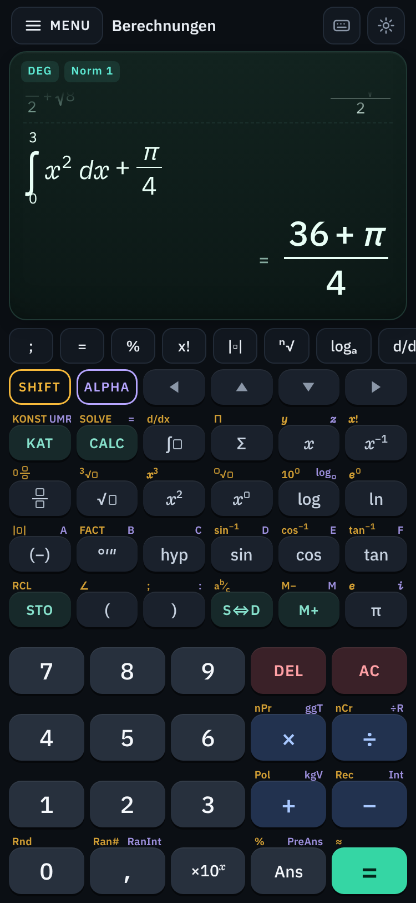
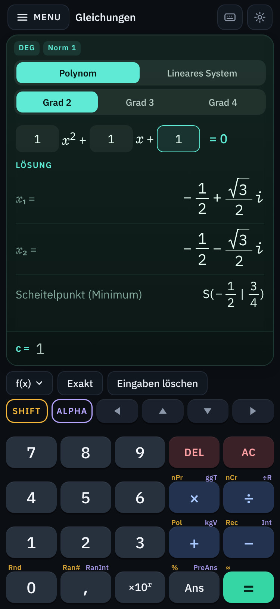
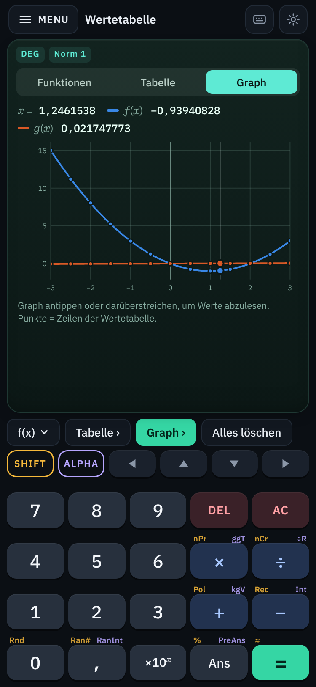
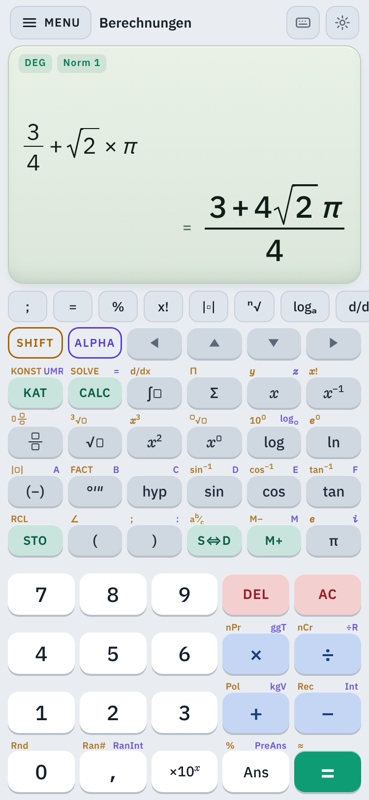

# Rechenwerk

**Wissenschaftlicher Schul-Taschenrechner als installierbare Web-App (PWA).**
Natural Display, exakte Ergebnisse (Bruch, Wurzel, π), SHIFT/ALPHA-Belegung und zwölf Modi – läuft
vollständig offline im Browser, ohne Server und ohne Konto.



| Gleichungen | Wertetabelle mit Graph | Helles Design |
| --- | --- | --- |
|  |  |  |

---

## Am schnellsten aufs Handy

1. App veröffentlichen (einmalig, siehe [Veröffentlichung](#veröffentlichung)) – am einfachsten:
   `release/rechenwerk-dist.zip` entpacken und den Ordner auf <https://app.netlify.com/drop> ziehen.
2. Die angezeigte Adresse auf dem Handy öffnen.
3. **iPhone/iPad:** in **Safari** öffnen → **Teilen** (Quadrat mit Pfeil) → **„Zum Home-Bildschirm“** → Hinzufügen.
   **Android:** in **Chrome** öffnen → Menü **⋮** → **„App installieren“** (bzw. „Zum Startbildschirm hinzufügen“).

Danach startet Rechenwerk wie eine normale App im Vollbild und funktioniert auch ohne Internet.

---

## Funktionsübersicht

### Bedienung und Display

- **Eigene Bildschirmtastatur** (kein System-Keyboard) mit **SHIFT**- (gelb) und **ALPHA**-Zweitbelegung
  (violett), klein über den Tasten beschriftet.
- **Natural Display:** Brüche übereinander, Wurzeln, Potenzen, Beträge, Integrale, Summen und Produkte;
  der Cursor bewegt sich mit ◀ ▶ ▲ ▼ durch die Struktur, Antippen setzt ihn direkt.
- **Exakte Ergebnisse** als Bruch, Wurzelausdruck oder π-Vielfaches; **S⇔D** schaltet auf Dezimal um,
  **SHIFT + S⇔D** auf gemischte Brüche.
- **Verlauf:** frühere Eingaben mit ▲ zurückholen, bearbeiten und neu berechnen (oder antippen).
- **Ans**, **PreAns**, Variablen **A–F, x, y, z, M** mit **STO/RCL**, **M+ / M−**.
- **MENU** (oben links) öffnet die Modus-Auswahl, das Zahnrad die **Einstellungen**:
  DEG/RAD/GRA, Norm 1/2 · Fix · Sci, Dezimalkomma oder -punkt, Ergebnisformat exakt/dezimal,
  Brüche unecht/gemischt, komplexe Ergebnisse a+bi oder r∠θ, Dark/Light, Haptik, Zurücksetzen.
- **KAT** öffnet den Katalog aller Funktionen, **SHIFT + KAT** die physikalischen Konstanten,
  **ALPHA + KAT** die Einheitenumrechnung. Die **Kontextleiste** über der Tastatur bietet je Modus
  die passenden Zusatzfunktionen.
- Haptisches Feedback (Vibration, wo der Browser es unterstützt), Hoch- und Querformat,
  Bedienung am PC auch mit der Hardware-Tastatur.

### Die zwölf Modi

| Nr. | Modus | Inhalt |
| --- | --- | --- |
| 1 | **Berechnungen** | Grundrechenarten, Trigonometrie inkl. Umkehr- und Hyperbelfunktionen, log/ln/eˣ/10ˣ, n!, nPr, nCr, Zufallszahlen, Primfaktorzerlegung (FACT), ggT/kgV, Division mit Rest, Grad-Minuten-Sekunden, numerische Ableitung und Integration, Σ und Π, **CALC**, **SOLVE** (Newton-Verfahren mit Startwert), 42 physikalische Konstanten (CODATA 2018), Umrechnung zwischen 58 Einheiten in 10 Größenarten |
| 2 | **Komplexe Zahlen** | Rechnen in a+bi und Polarform r∠θ, Betrag, Argument, konjugiert, Real-/Imaginärteil |
| 3 | **Basis-N** | DEC/HEX/BIN/OCT (32 Bit), and/or/xor/xnor/Not/Neg, Ergebnis gleichzeitig in allen Basen |
| 4 | **Matrizen** | MatA–MatD bis 4×4: Addition, Multiplikation, Determinante, Inverse, Transponierte, Potenzen, Einheitsmatrix, Zeilenstufenform |
| 5 | **Vektoren** | VctA–VctD in 2D/3D: Skalarprodukt, Kreuzprodukt, Betrag, Winkel, Einheitsvektor |
| 6 | **Statistik** | 1 und 2 Variablen mit Dateneditor (optional Häufigkeiten), Kennwerte inkl. Quartile; Regression linear, quadratisch, logarithmisch, e-Funktion, a·bˣ, Potenz, invers – mit r, r² und Schätzwerten x̂, ŷ |
| 7 | **Verteilungen** | Normal-, Binomial- und Poisson-Verteilung: Dichte/Einzelwahrscheinlichkeit, kumulativ, invers |
| 8 | **Wertetabelle** | f(x) und g(x), Start/Ende/Schritt – plus **Funktionsgraph** zum Ablesen per Fingertipp |
| 9 | **Gleichungen** | Lineare Gleichungssysteme mit 2–4 Unbekannten; Polynome Grad 2–4 inkl. komplexer Lösungen, exakt wo möglich, bei Grad 2 mit Scheitelpunkt |
| 10 | **Ungleichungen** | Polynome Grad 2–4, Lösungsmenge als Bedingungen und in Intervallschreibweise |
| 11 | **Verhältnis** | a : b = c : x und a : b = x : d |
| 12 | **Tabellenkalkulation** | 5 Spalten × 45 Zeilen mit Formeln, Zellbezügen (A1), Bereichen (A1:B3), Summe/Mittel/Min/Max, Ausfüllen nach unten/rechts |

### Tastenbelegung im Überblick

| Taste | SHIFT | ALPHA |
| --- | --- | --- |
| KAT (Katalog) | KONST (Konstanten) | UMR (Umrechnung) |
| CALC | SOLVE | = |
| ∫ | d/dx | |
| Σ | Π | |
| x | y | z |
| x⁻¹ | x! | |
| Bruch | gemischter Bruch | |
| √ | ∛ | |
| x² | x³ | |
| xⁿ | ⁿ√ | |
| log | 10ˣ | log zur Basis a |
| ln | eˣ | |
| (−) | Betrag | A |
| °′″ | FACT | B |
| hyp | | C |
| sin · cos · tan | sin⁻¹ · cos⁻¹ · tan⁻¹ | D · E · F |
| STO | RCL | |
| ( | ∠ | |
| ) | ; | : |
| S⇔D | gemischter Bruch ⇔ unechter Bruch | |
| M+ | M− | M |
| π | e | i |
| × · ÷ | nPr · nCr | ggT · ÷R |
| + · − | Pol · Rec | kgV · Int |
| 0 · , · Ans · = | Rnd · Ran# · % · ≈ | – · RanInt · PreAns · – |

Funktionsargumente werden mit **Semikolon** getrennt, z. B. `ggT(12;18)`.

---

## Lokal starten

Voraussetzung: [Node.js](https://nodejs.org) ab Version 20.

```bash
npm install
```

```bash
npm run dev
```

Die App läuft dann unter <http://localhost:5173>. Weitere Befehle:

| Befehl | Zweck |
| --- | --- |
| `npm run build` | Typprüfung und Produktions-Build nach `dist/` (inkl. Service Worker) |
| `npm run preview` | den Build lokal ausliefern (zum Testen der PWA, auch im WLAN vom Handy aus erreichbar) |
| `npm test` | Unit-Tests des Rechenkerns, des Editors und der Bedienlogik (Vitest, rund 390 Testfälle) |
| `npm run test:e2e` | End-to-End-Tests (Playwright, Handy-Formate 375×812 und 412×915) |
| `npm run zip` | `dist/` als `release/rechenwerk-dist.zip` verpacken |
| `npm run icons` | App-Icons aus dem SVG neu erzeugen |

Für die End-to-End-Tests wird einmalig ein Browser benötigt:

```bash
npx playwright install chromium
```

---

## Veröffentlichung

Der Build verwendet **relative Pfade**. Derselbe Ordner `dist/` funktioniert deshalb unverändert unter
GitHub Pages (`https://<name>.github.io/<repo>/`), bei Netlify und in jedem anderen Unterverzeichnis.
Wichtig ist nur **HTTPS** – ohne HTTPS lässt sich eine PWA nicht installieren.

### Variante A: Netlify per Drag & Drop (ohne Konto-Einrichtung, zwei Minuten)

1. `release/rechenwerk-dist.zip` herunterladen und entpacken (oder selbst `npm run build` ausführen).
2. <https://app.netlify.com/drop> öffnen und den entpackten Ordner (bzw. `dist/`) in das Fenster ziehen.
3. Netlify zeigt sofort eine HTTPS-Adresse an – diese auf dem Handy öffnen und installieren.

### Variante B: GitHub Pages (automatisch bei jedem Push)

Der Workflow `.github/workflows/deploy.yml` testet, baut und veröffentlicht die App automatisch.

1. Im Repository **Settings → Pages → Build and deployment → Source: „GitHub Actions“** wählen (einmalig).
2. Auf den Standard-Branch pushen (oder unter **Actions** den Workflow
   „Auf GitHub Pages veröffentlichen“ manuell über **Run workflow** starten).
3. Nach etwa einer Minute ist die App unter `https://<benutzername>.github.io/<repository>/` erreichbar.

Veröffentlicht wird nur vom Standard-Branch des Repositorys; auf anderen Branches laufen lediglich Tests und Build.

---

## Installation auf dem Handy

### iPhone / iPad

1. Die Adresse der App in **Safari** öffnen (andere Browser können auf iOS keine Web-Apps installieren).
2. Unten auf **Teilen** tippen (Quadrat mit Pfeil nach oben).
3. **„Zum Home-Bildschirm“** wählen und mit **Hinzufügen** bestätigen.
4. Rechenwerk über das neue Symbol starten – die App läuft im Vollbild und offline.

### Android

1. Die Adresse der App in **Chrome** öffnen.
2. Menü **⋮** antippen → **„App installieren“** (je nach Version „Zum Startbildschirm hinzufügen“)
   oder den eingeblendeten Installationshinweis bestätigen.
3. Rechenwerk erscheint in der App-Übersicht und startet ohne Browser-Leisten.

Ein Update wird automatisch im Hintergrund geladen und ist beim nächsten Start aktiv.

---

## Bekannte Einschränkungen

- **Kein CAS:** Es wird numerisch bzw. mit exakten Brüchen, Wurzeln und π-Vielfachen gerechnet –
  keine symbolische Umformung, keine Variablen in Ergebnissen. Integrale und Ableitungen sind numerisch.
- **Integrale:** Integranden mit einer Singularität an der Grenze 0 (z. B. 1/√x von 0 bis 1) werden
  berechnet; liegt die Singularität an einer anderen Grenze oder im Inneren, oder divergiert das
  Integral, gibt es eine Fehlermeldung statt eines unsicheren Werts.
- **SOLVE** findet eine Lösung in der Nähe des Startwerts (Newton-Verfahren); bei mehreren Lösungen
  entscheidet der Startwert, Polstellen werden nicht als Lösung ausgegeben.
- **Exakte Ergebnisse** gibt es für Brüche, Quadratwurzeln und π-Vielfache (bis zu drei Summanden,
  Zahlen unter 10 Stellen); alles andere wird dezimal mit 10 signifikanten Stellen angezeigt.
  Intern wird mit 64-Bit-Gleitkommazahlen gerechnet (ca. 15–16 Stellen).
- **Polynomgleichungen:** rationale Lösungen und quadratische Restfaktoren exakt, sonst numerisch
  (z. B. x³ = 2). Mehrfache Lösungen werden nur einmal angezeigt.
- **Basis-N** rechnet mit 32-Bit-Ganzzahlen (auch im Binärsystem).
- **Wertetabelle:** höchstens 100 Zeilen; der Graph ist eine Übersicht (Polstellen werden abgeschnitten),
  kein vollwertiger Funktionsplotter mit Zoom.
- **Tabellenkalkulation:** nur Zahlen und Formeln (kein Text), relative Zellbezüge.
- **Haptik:** `navigator.vibrate` gibt es auf Android (Chrome), nicht auf iOS – dort bleibt die App stumm.
- **iOS:** Installation nur über Safari; iOS kann den Speicher selten genutzter Web-Apps leeren
  (Verlauf und Variablen gehen dann verloren, die App selbst nicht).
- Ganz kleine Displays (unter ca. 340 × 600 Punkten) werden eng; im Querformat sind die Tasten kleiner.
- Physikalische Konstanten nach CODATA 2018.

---

## Aufbau des Projekts

```
src/core/      Rechenkern ohne jede UI-Abhängigkeit (exakte Arithmetik, Parser, Auswertung,
               Numerik, komplexe Zahlen, Matrizen, Statistik, Verteilungen, Gleichungen, …)
src/editor/    Modell und Darstellung des 2D-Formeleditors (Natural Display)
src/ui/        App-Gerüst, Bildschirmtastatur, Dialoge, Zustand und Speicherung
src/modes/     die zwölf Modi
src/styles/    Design (dunkles und helles Thema)
tests/unit/    Unit-Tests des Rechenkerns und des Editors (Vitest)
tests/e2e/     End-to-End-Tests auf Handy-Formaten (Playwright)
public/        Manifest und Icons
dist/          fertiger Build (zum direkten Hochladen)
release/       derselbe Build als ZIP
```

Die getroffenen Entwurfsentscheidungen stehen in [DECISIONS.md](DECISIONS.md).

Schriften: IBM Plex Sans und IBM Plex Mono (SIL Open Font License), lokal eingebunden.
